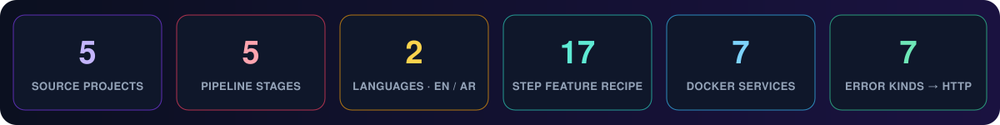
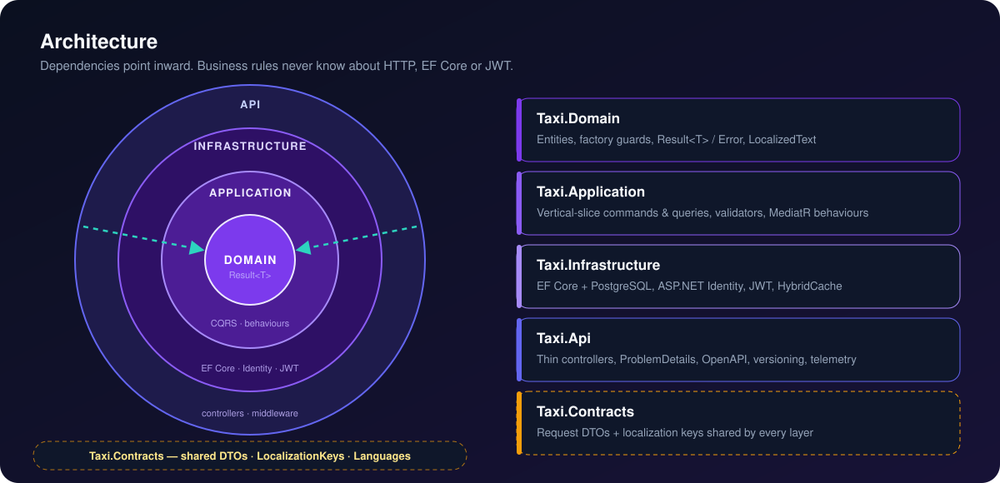
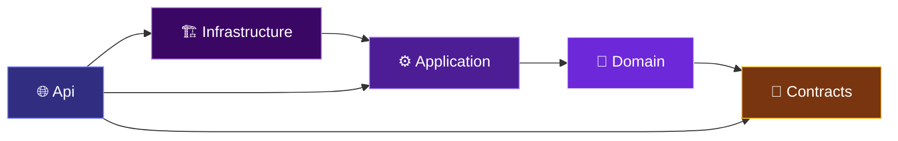
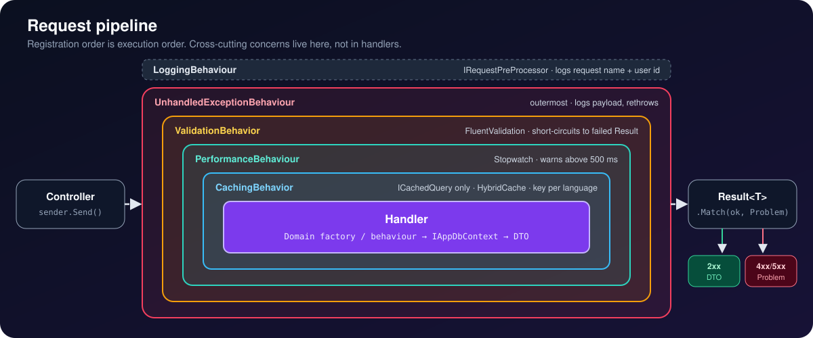
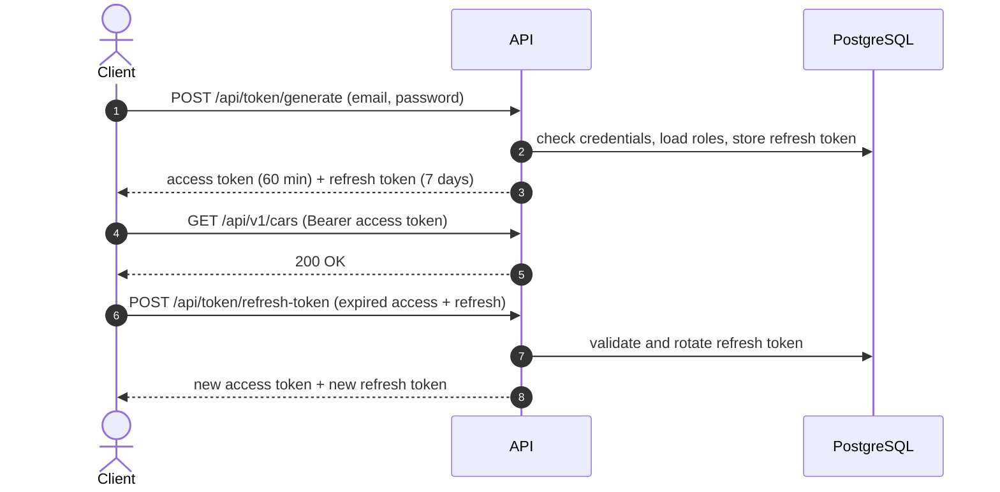
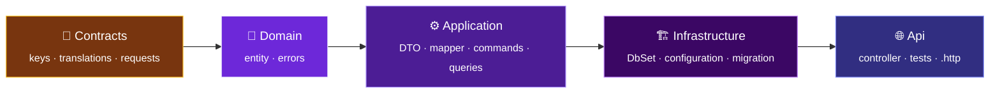

<!-- markdownlint-disable MD033 MD041 MD013 -->
<div align="center">



<br/>

[](https://github.com/fat7i-alghareeb/BackEnd_templete/actions/workflows/build-and-test.yml)


[](LICENSE)

**A reusable .NET 10 backend template with Clean Architecture and CQRS,<br/>ready for new APIs with authentication, caching, logging and testing.**

[Quick start](#-quick-start) ·
[Features](#-features) ·
[Architecture](#-architecture) ·
[API](#-api-surface) ·
[Add a feature](#-adding-a-feature) ·
[Visual tour](docs/SHOWCASE.md)

</div>

> [!NOTE]
> **Not a taxi app.** `Taxi.*` is only the placeholder root namespace. `Car` and `Driver` are the
> reference features that show the whole pattern end to end. Rename the namespace
> ([Make it yours](#-make-it-yours)), replace `Car` and `Driver` with your own entities, and keep
> the plumbing.



> [!TIP]
> **Working with an AI coding agent?** Point it at [AGENTS.md](AGENTS.md) first. It holds the hard
> rules, a 17-step feature checklist that names the real file to copy at each step, and a routing
> table to the per-layer blueprints. For Claude Code there are slash commands (`/first-run`,
> `/build-project`, `/new-feature`, `/finish`) and a feature generator that writes ~25 files in one
> command: see [docs/USING_CLAUDE.md](docs/USING_CLAUDE.md). Ready-made task briefs are in
> [prompts/](prompts/README.md).

## ✨ Features

| | Feature | What you get |
|:-:|:--|:--|
| 🧅 | **Clean Architecture** | Domain, Application, Infrastructure, Api and Contracts projects with dependencies pointing inward, enforced by architecture tests |
| ⚡ | **CQRS with MediatR** | One folder per use case, plus a pipeline for logging, validation, timing and caching |
| 🧾 | **Result pattern** | `Result<T>` instead of exceptions for business failures, mapped to RFC 7807 `ProblemDetails` in one place |
| 🔐 | **JWT + refresh tokens + RBAC** | HMAC-SHA256 access tokens, rotating refresh tokens (one live per user), role claims behind named policies, account lockout, self-service register / confirm / reset / change password |
| 🌍 | **English / Arabic** | Localized error, validation and email messages, bilingual fields stored as JSONB, chosen by `Accept-Language` |
| 🐘 | **PostgreSQL + EF Core 10** | Migrations with retry, audit stamping, soft delete, `xmin` optimistic concurrency, a transactional outbox for domain events |
| 🚀 | **HybridCache + Redis** | Opt-in query caching, split by language, cleared by tags; Redis L2 shares it across instances |
| 🛡️ | **Hardening** | Per-user / per-IP rate limiting, `Idempotency-Key` on creating POSTs, security headers, request-size limits, file uploads checked by magic bytes |
| 🔖 | **API versioning** | URL-segment versions; cars ship a deprecated v1 with a `Sunset` header and a v2 with a different shape |
| 📈 | **Observability** | Serilog, OpenTelemetry, Seq, Prometheus and Grafana, health probes, all started by Docker Compose |
| 🧪 | **Tests + CI** | Unit, architecture and Testcontainers integration suites; StyleCop on every build; GitHub Actions with coverage |
| 📚 | **Docs + workflow** | Per-layer blueprints, REST naming rules, a 17-step feature recipe, AI prompt templates |

## 🚀 Quick start

**You need:** the [.NET 10 SDK](https://dotnet.microsoft.com/download) and
[Docker Desktop](https://www.docker.com/products/docker-desktop/).

```bash
git clone https://github.com/fat7i-alghareeb/BackEnd_templete.git
cd BackEnd_templete
```

Pick **one** of the two ways to run it (running both at once means two API instances on one
database).

### Option A: everything in Docker

```bash
docker compose up -d --build
```

Builds the API image and starts it with PostgreSQL, Redis, Seq, Mailpit, Prometheus and Grafana.
The API is at **<http://localhost:5001>** (Swagger UI at `/swagger`). Migrations and seed data are
applied on startup. Prometheus and Grafana wait for the API to report healthy, which takes up to a
minute on the first start.

| Service | Host port | Role |
|:--|:--|:--|
| 🌐 `taxi.api` | `5001` → container `8080` | the API; image `HEALTHCHECK` on `/health/live` |
| 🐘 PostgreSQL 16 | `5433` | database |
| 🧠 Redis 7 | `6379` | HybridCache L2 and distributed locks |
| 📬 Mailpit (development only) | `8025` (UI) · `1025` (SMTP) | catches account emails: read confirmation and reset links here |
| 📜 Seq | `8081` (UI) · `5341` (ingest) | logs and traces |
| 📈 Prometheus | `9090` | scrapes `/metrics` every 5 s |
| 📊 Grafana | `3000` | dashboards; log in as `admin` / `YourStrongPwd`, then add a Prometheus data source at `http://prometheus:9090` (none is provisioned) |

### Option B: API on your machine, database in Docker

```bash
docker compose up -d postgres        # PostgreSQL on localhost:5433
dotnet run --project src/Taxi.Api    # http://localhost:5000 (Swagger UI at /swagger)
```

Migrations and seed data are applied on startup. Add `redis`, `seq` and `mailpit` to the
`docker compose up -d` line if you want them; the API uses an in-process cache and logs emails to
the console until you point it at them:

```bash
export ConnectionStrings__Redis=localhost:6379
export Email__Provider=Smtp Email__Smtp__Host=localhost Email__Smtp__Port=1025 Email__Smtp__Security=None
```

(PowerShell: `$env:ConnectionStrings__Redis = "localhost:6379"`.) The Seq log sink already points at
`localhost:5341` in Development.

### First calls

Sign in with a seeded Development account, then call a protected endpoint (use port `5001` for
Option A):

```bash
curl -s -X POST http://localhost:5000/api/token/generate \
  -H "Content-Type: application/json" \
  -d '{"email":"admin@taxi.com","password":"Admin123!"}'
# → {"accessToken":"…","refreshToken":"…","expiresOnUtc":"…"}

curl -s http://localhost:5000/api/v1/cars -H "Authorization: Bearer <accessToken>"
```

In Swagger UI, click **Authorize** and paste the access token. More calls, including every
failure path, are in [requests/requests.http](requests/requests.http).

| Account | Password | Role | Can do |
|:--|:--|:--|:--|
| `admin@taxi.com` | `Admin123!` | `Manager` | everything |
| `user@taxi.com` | `User123!` | `User` | read; writes answer 403 |

They come from `Seed:Admin` and `Seed:User` in `appsettings.Development.json`. Any other
environment seeds an account only when `Seed__Admin__Email` and `Seed__Admin__Password` are set.

In **Development** the API documentation is served at:

| Tool | URL |
|:--|:--|
| 📘 OpenAPI documents | `/openapi/v2.json` · `/openapi/v1.json` (deprecated) |
| 🧭 Swagger UI | `/swagger` |
| ✨ Scalar | `/scalar/v2` · `/scalar/v1` |

In every environment `/health/live` (process is up) and `/health/ready` (PostgreSQL, and Redis when
configured, are reachable) answer 200 or 503 without authentication, and `/metrics` serves
Prometheus.

> [!CAUTION]
> The development JWT secret and the seeded passwords are public placeholders committed to this
> repository. Anyone reading the repo can forge tokens signed with that secret. Override
> `JwtSettings:Secret` and set your own seed credentials before running anywhere other than your own
> machine.

## 🧬 Make it yours

The template is called **Taxi**. Rename it once, on a fresh clone, before your first commit and
before you run it (needs [PowerShell 7](https://learn.microsoft.com/powershell/scripting/install/installing-powershell),
`pwsh`, on Windows, macOS or Linux):

```bash
pwsh ./rename.ps1 -Name Acme -WhatIf   # preview every file that would change
pwsh ./rename.ps1 -Name Acme           # Taxi → Acme everywhere
```

It rewrites file contents (`Taxi` / `taxi` / `TAXI`, so namespaces, the solution, compose services,
the database name, the JWT issuer, the Redis key prefix and these docs all follow), renames every
`Taxi.*` project, folder and file, gives the project a fresh `UserSecretsId`, and re-sorts `using`
directives so the strict CI build stays clean. It refuses to run on a dirty git tree unless you
pass `-Force`, skips `.git`, build output and `LICENSE`, and accepts a PascalCase `-Name`.

Afterwards: run `dotnet build` and `dotnet test`, then delete this section, the "Not a taxi app"
note and `rename.ps1` if you like. Existing databases are not migrated (the default database
becomes `<Name>Db`, and the outbox stores CLR type names), so start from an empty one
(`docker compose down -v`).

## 🔧 Configuration

For local development nothing is needed: `appsettings.Development.json` already has a working
connection string and JWT secret.

Everywhere else, `ConnectionStrings:DefaultConnection` and `JwtSettings:Secret` are blank in
`appsettings.json` on purpose. Supply them with user secrets, environment variables or a `.env`
file (see [.env.example](.env.example)):

```bash
dotnet user-secrets set "ConnectionStrings:DefaultConnection" "Host=localhost;Port=5433;Database=TaxiDb;Username=postgres;Password=..." --project src/Taxi.Api
dotnet user-secrets set "JwtSettings:Secret" "<at least 32 characters>" --project src/Taxi.Api
```

As environment variables, `:` becomes `__` (`JwtSettings__Secret`) and array items take an index
(`AppSettings__AllowedOrigins__0`).

<details>
<summary><b>All configuration keys</b></summary>

<br/>

| Key | Default | Purpose |
|:--|:--|:--|
| `ConnectionStrings:DefaultConnection` | *(blank)* | PostgreSQL. Required: the host throws at startup when blank |
| `ConnectionStrings:Redis` | *(blank)* | HybridCache L2 and distributed locks. Blank = in-process cache and lock (single instance) |
| `JwtSettings:Secret` | *(blank)* | HMAC key. The host refuses to start unless it is at least 32 characters |
| `JwtSettings:Issuer` / `Audience` | `TaxiServer` / `TaxiClient` | token issuer and audience |
| `JwtSettings:TokenExpirationInMinutes` | `60` | access token lifetime (1–1440) |
| `JwtSettings:RefreshTokenExpirationInDays` | `7` | refresh token lifetime (1–365) |
| `Database:ApplyMigrationsOnStartup` | on outside Production; `true` in `appsettings.Production.json` | apply migrations and seed on startup, with 5 retries. Set `false` to migrate in your pipeline |
| `Database:ResetOnStartup` | `false` | drop and recreate the database; honoured in Development only |
| `Seed:Admin:*`, `Seed:User:*` | *(blank)* | `Email` + `Password` of a `Manager` / `User` account to create. Both must be set |
| `Seed:SampleData` | `false` | insert one sample car into an empty database |
| `Email:Provider` | `Log` | `Log` writes emails (and their one-time links) to the log; `Smtp` sends through `Email:Smtp:*` |
| `Email:FromAddress` / `FromName` | `no-reply@taxi.local` / `Taxi` | sender |
| `Email:Smtp:Host` / `Port` / `Security` / `Username` / `Password` | blank / `587` / `StartTls` / blank / blank | required (`Host`) when the provider is `Smtp`; `Security` is `None`, `StartTls` or `SslOnConnect` |
| `ClientApp:ConfirmEmailUrl` / `ResetPasswordUrl` | `http://localhost:5002/account/…` | front-end pages the account emails link to (`?userId=&token=` / `?email=&token=`) |
| `FileStorage:LocalRootPath` | `storage` | where uploads are written, relative to the content root (`src/Taxi.Api/` under `dotnet run`, `/app/storage` in the container) |
| `Outbox:Enabled` | `true` | run the domain-event processor on this instance |
| `Outbox:PollingIntervalSeconds` / `BatchSize` / `MaxAttempts` / `RetentionDays` | `5` / `20` / `5` / `7` | outbox tuning |
| `RateLimiting:Default:*` | `100` permits / `60` s, 6 segments, queue `10` | per-user (else per-IP) sliding window on every controller |
| `RateLimiting:Auth:*` | `10` permits / `60` s | per-IP fixed window on the credential and account endpoints |
| `Kestrel:Limits:MaxRequestBodySize` | `1048576` | request body cap in bytes; larger bodies get 413 (the image upload allows 5 MB) |
| `ForwardedHeaders:*` | `XForwardedFor, XForwardedProto, XForwardedHost`, limit `1`, no proxies | trust a reverse proxy: set `KnownProxies` / `KnownIPNetworks` |
| `AppSettings:CorsPolicyName` / `AllowedOrigins` | `TaxiCorsPolicy` / `http://localhost:5002`, `https://localhost:7008` | CORS |
| `Serilog:*` | console + daily file `logs/log-.txt`; Seq added in Development | logging |
| `OTEL_EXPORTER_OTLP_ENDPOINT` / `OTEL_EXPORTER_OTLP_PROTOCOL` | unset | OpenTelemetry trace export; compose points them at Seq |

</details>

## 🧅 Architecture





| Project | Role |
|:--|:--|
| `Taxi.Domain` | Entities, invariants, `<Entity>Errors`, `Result<T>` / `Error`, `LocalizedText`, domain events |
| `Taxi.Contracts` | Request DTOs, `LocalizationKeys`, `Languages`, sort whitelists |
| `Taxi.Application` | Commands, queries, handlers, validators, DTOs, MediatR behaviours, the interfaces others implement |
| `Taxi.Infrastructure` | EF Core + PostgreSQL, ASP.NET Identity, JWT, HybridCache / Redis, outbox, file storage, email, health checks |
| `Taxi.Api` | Controllers, middleware, OpenAPI, versioning, rate limiting, composition root |

Four test projects mirror them: `Taxi.Domain.UnitTests`, `Taxi.Application.UnitTests`,
`Taxi.ArchitectureTests` and `Taxi.Api.IntegrationTests`.

### Request pipeline



Controllers stay thin: build the query or command, send it, match the result.

```csharp
[HttpGet("{id:guid}")]
public async Task<IActionResult> GetCar(Guid id, CancellationToken ct)
{
    var result = await this.sender.Send(new GetCarByIdQuery(id), ct);
    return result.Match(this.Ok, this.Problem);
}
```

## 🌐 API surface

All `/api/v1` and `/api/v2` routes need a bearer token unless marked open. 🔒 = any signed-in user;
🔒 Manager = the `Manager` role.

| Method | Route | Auth | Description |
|:--|:--|:-:|:--|
|  | `/api/token/generate` | | Sign in, get access + refresh token (one uniform 401 for any bad credential) |
|  | `/api/token/refresh-token` | | Swap an expired access token + refresh token for new ones (409 if invalid or expired) |
|  | `/api/token/user-info` | 🔒 | Current user, roles and claims |
|  | `/api/account/register` | | Create an account (role `User`); a confirmation email follows. Always 202 |
|  | `/api/account/confirm-email` | | Confirm with the emailed `userId` + `token` |
|  | `/api/account/resend-confirmation` | | Send the confirmation email again. Always 202 |
|  | `/api/account/forgot-password` | | Email a reset link. Always 202 |
|  | `/api/account/reset-password` | | Set a new password with the emailed token; revokes the user's refresh tokens |
|  | `/api/account/change-password` | 🔒 | Change own password; revokes refresh tokens |
|  | `/api/account/logout` | 🔒 | Revoke the refresh token (the access token lives until it expires) |
|  | `/api/v1/users/{userId}/roles` | 🔒 Manager | Replace a user's roles |
|  | `/api/v2/cars` · `/api/v2/cars/{id}` | 🔒 | **v2**: cars with the description in both languages + timestamps |
|  | `/api/v1/cars` | 🔒 | List cars: paged, filtered, sorted (cached per language). **v1 is deprecated** (`Sunset` header); writes work on both `v1` and `v2` |
|  | `/api/v1/cars/{id}` | 🔒 | One car (cached per language) |
|  | `/api/v1/cars` | 🔒 Manager | Create a car; send `Idempotency-Key` to make retries safe |
|  | `/api/v1/cars/{id}` | 🔒 Manager | Update a car |
|  | `/api/v1/cars/{id}` | 🔒 Manager | Soft-delete a car (409 while a driver is assigned to it) |
|  | `/api/v1/cars/{id}/image` | 🔒 Manager | Upload/replace the image (multipart `file`, JPEG/PNG/WebP, ≤ 5 MB) |
|  | `/api/v1/cars/{id}/image` | 🔒 | Download the image |
|  | `/api/v1/cars/{id}/image` | 🔒 Manager | Remove the image |
|  | `/api/v1/drivers` · `/api/v1/drivers/{id}` | 🔒 | List (paged, `search`) / get drivers with their certifications |
|  | `/api/v1/drivers` | 🔒 Manager | Create a driver (unique licence number); idempotent with `Idempotency-Key` |
|   | `/api/v1/drivers/{id}` | 🔒 Manager | Update / delete a driver |
|   | `/api/v1/drivers/{id}/certifications[/{certId}]` | 🔒 Manager | Add / remove a certification (child collection) |
|   | `/api/v1/drivers/{id}/car` | 🔒 Manager | Assign / unassign a car (one driver per car; an assigned car cannot be deleted) |

Writes and image routes accept both `v1` and `v2` (a `POST` to `/api/v2/cars` answers
`Location: /api/v2/cars/{id}`); drivers and users are `v1` only. A `v3` route is a 404.

**Listing cars** takes `page`, `pageSize` (max 100, clamped), `search` (make or model contains),
`make`, `year`, `sortBy` (`make`, `model`, `year`, `createdAt`) and `sortDirection` (`asc`, `desc`),
and returns:

```json
{ "items": [], "page": 1, "pageSize": 20, "totalCount": 0, "totalPages": 0,
  "hasPreviousPage": false, "hasNextPage": false }
```

**Errors** always come back as `ProblemDetails`, translated by `Accept-Language`:

<table>
<tr><th width="50%"><code>Accept-Language: en</code></th><th width="50%"><code>Accept-Language: ar</code></th></tr>
<tr>
<td>

```json
{
  "type": "https://tools.ietf.org/html/rfc9110#section-15.5.5",
  "title": "Car not found",
  "status": 404,
  "instance": "GET /api/v1/cars/3f2a…",
  "traceId": "00-…",
  "requestId": "0HN7…:00000001"
}
```

</td>
<td>

```json
{
  "type": "https://tools.ietf.org/html/rfc9110#section-15.5.5",
  "title": "السيارة غير موجودة",
  "status": 404,
  "instance": "GET /api/v1/cars/3f2a…",
  "traceId": "00-…",
  "requestId": "0HN7…:00000001"
}
```

</td>
</tr>
</table>

| `ErrorKind` | `Validation` | `Unauthorized` | `Forbidden` | `NotFound` | `Conflict` | `Failure` / `Unexpected` |
|:--|:-:|:-:|:-:|:-:|:-:|:-:|
| **HTTP** | 400 | 401 | 403 | 404 | 409 | 500 |

Validation failures use `ValidationProblemDetails` with an `errors` object keyed by field. Other
statuses you can meet: `413` (body too large), `422` (an `Idempotency-Key` reused with a different
body), `429` (rate limited, with `Retry-After`), `503` (a health check failed). The full contract is
in the [REST naming constitution](docs/RESTful_Naming_Constitution.md).

## 🔐 Authentication



- **Access token:** JWT signed with HMAC-SHA256, carrying the user id, email and `role` claims.
- **Refresh token:** stored in the database, one live token per user, rotated on every refresh and
  revoked by logout and by password change or reset.
- **RBAC:** `Manager` and `User` roles; endpoints use named policies (`CanReadCars`,
  `CanManageCars`, `CanReadDrivers`, `CanManageDrivers`, `CanManageUsers`) behind a fallback policy
  that requires authentication everywhere. New self-registered accounts are `User`.
- **Brute-force guard:** five wrong passwords lock an account for 15 minutes; the credential and
  account endpoints share a strict per-IP rate limit; unknown email, wrong password and lockout all
  answer the same 401.
- **Hardening:** CORS from config, forwarded-headers settings, per-user / per-IP rate limiting,
  security headers (CSP, nosniff, frame-deny, referrer policy), HSTS outside Development, no
  `Server` header, and a 1 MB request body limit (413).

## 🌍 Localization

English and Arabic out of the box. Error codes and validation messages are `LocalizationKeys`
constants resolved at the API boundary against
[`SharedResource.en.json`](src/Taxi.Api/Resources/SharedResource.en.json) and
[`SharedResource.ar.json`](src/Taxi.Api/Resources/SharedResource.ar.json); account emails are
translated the same way. Translatable entity fields use the `LocalizedText` value type, stored as a
single JSONB column and returned in the language the client asks for (`Accept-Language: ar`);
unsupported or missing headers fall back to English.

## 📈 Observability

Logs go through Serilog to the console and a daily rolling file (`logs/log-.txt`), plus Seq in
Development. Traces and metrics come from OpenTelemetry: traces are exported over OTLP to Seq
(compose sets the endpoint), metrics are served at `/metrics` for Prometheus. Every problem
response carries a `requestId` and `traceId`, and every log line of a request carries its
`CorrelationId`. `PerformanceBehaviour` logs a warning for any request slower than 500 ms. Ports
and roles of the stack are in the [Quick start](#-quick-start) table.

## 🐳 Deployment

The production compose file layers on top of the base file and reads its secrets from `.env`:

```bash
cp .env.example .env        # then edit every value
docker compose -f docker-compose.yml -f docker-compose.prod.yml up -d --build
```

It runs in the `Production` environment: no Swagger, Scalar or OpenAPI endpoints, HSTS on,
migrations applied at startup, no seeded accounts unless `SEED_ADMIN_EMAIL` / `SEED_ADMIN_PASSWORD`
are set. Only the API is published (host port `5001`, plain HTTP); PostgreSQL, Redis, Seq,
Prometheus and Grafana stay on the internal network. Uploads live in the `api-storage` volume, data
in `postgres-data`.

Before you expose it:

- put a reverse proxy in front for TLS, and set `ForwardedHeaders__KnownProxies__0` or
  `ForwardedHeaders__KnownIPNetworks__0` so client IPs (and rate-limit buckets) are real;
- set `ClientApp__ConfirmEmailUrl`, `ClientApp__ResetPasswordUrl` and
  `AppSettings__AllowedOrigins__0` for your front end: the compose file does not set them and the
  defaults point at `localhost`;
- keep `/metrics` off the public internet (it is anonymous), and publish Seq / Grafana only behind
  authentication;
- replace the relaxed password policy (6 characters) if you need a stricter one;
- set `Database__ApplyMigrationsOnStartup=false` if you run migrations from your pipeline;
- persist and share ASP.NET Core Data Protection keys before running several instances
  (email-confirmation and password-reset tokens depend on them);
- back up the `postgres-data` and `api-storage` volumes.

## 🧩 Adding a feature

Every feature follows the same 17-step recipe in [AGENTS.md](AGENTS.md), copying the matching
`Car` (or `Driver`) file at each step:



```text
src/Taxi.Application/Features/Cars/
├── Commands/   CreateCar · UpdateCar · RemoveCar · UploadCarImage · RemoveCarImage
├── Queries/    GetCars · GetCarById · GetCarDetails · GetCarDetailsById · GetCarImage
├── Dtos/       CarDto · CarDetailsDto · LocalizedTextDto
├── Mappers/    CarMapper
└── EventHandlers/  CarCreatedDomainEventHandler
```

Working with an AI agent? Use the templates in [prompts/](prompts/README.md).

## 🧪 Build and test

```bash
dotnet build Taxi_Server.slnx -c Debug
dotnet test Taxi_Server.slnx
dotnet list package --vulnerable --include-transitive
```

| Suite | Covers |
|:--|:--|
| `Taxi.Domain.UnitTests` | `Car`, `Driver` and `RefreshToken` factory guards, `Result<T>` conversions |
| `Taxi.Application.UnitTests` | handlers (EF InMemory + NSubstitute), validators, mappers, `CachingBehavior`, pipeline order, cache serialization |
| `Taxi.ArchitectureTests` | layer arrows and conventions from `AGENTS.md`, enforced with NetArchTest |
| `Taxi.Api.IntegrationTests` | the real API against PostgreSQL in Docker (Testcontainers): auth, RBAC, localization, caching, soft delete, concurrency, idempotency, outbox, uploads, rate limiting, versioning, health |

The integration suite needs a running Docker daemon; everything else runs anywhere. Run one suite
with `dotnet test tests/<Project>`.

Coverage, as CI collects it (the job summary shows the table and the HTML report is attached as an
artifact):

```bash
dotnet test Taxi_Server.slnx --settings coverlet.runsettings --collect:"XPlat Code Coverage" --results-directory ./coverage
```

StyleCop runs as part of every build, and package versions are managed centrally in
`Directory.Packages.props`. CI builds with `-warnaserror`, fails on any vulnerable package (direct
or transitive), runs every suite with coverage, builds the Docker image and lints the Markdown;
Dependabot opens grouped weekly updates for NuGet, GitHub Actions and the base images.

## 📚 Documentation

| Document | Read it when |
|:--|:--|
| 🤖 [AGENTS.md](AGENTS.md) | you are adding a feature: hard rules and the 17-step checklist |
| 🧭 [docs/NAVIGATION.md](docs/NAVIGATION.md) | you don't know which file to open |
| 🤖 [docs/USING_CLAUDE.md](docs/USING_CLAUDE.md) | you use Claude Code: commands, scripts, token habits |
| 🩺 [docs/TROUBLESHOOTING.md](docs/TROUBLESHOOTING.md) | something fails on first run |
| 🤝 [CONTRIBUTING.md](CONTRIBUTING.md) | you want to contribute |
| 🔒 [SECURITY.md](SECURITY.md) | you found a vulnerability |
| 🏛️ [docs/ARCHITECTURE.md](docs/ARCHITECTURE.md) | you want the layers, pipeline and request lifecycle |
| 📐 [docs/RESTful_Naming_Constitution.md](docs/RESTful_Naming_Constitution.md) | you are naming a route or picking a status code |
| 📘 `src/Taxi.<Layer>/<Layer>_Layer_Blueprint.md` | you need the deep reference for one layer |
| 📝 [prompts/](prompts/README.md) | you are briefing an AI agent |
| 🎨 [docs/SHOWCASE.md](docs/SHOWCASE.md) | you want the visual tour of the whole template |
| 🧪 [requests/requests.http](requests/requests.http) | you want working sample calls |

## 🛠️ Tech stack

<p>


</p>

## 📄 License

Released under the [MIT License](LICENSE). Use it as the starting point for your own projects,
commercial or not; keep the copyright notice.

<div align="center">


<sub>Built by <a href="https://github.com/fat7i-alghareeb">Fathi Alghareeb</a> · .NET 10 · Clean Architecture · CQRS</sub>

</div>
